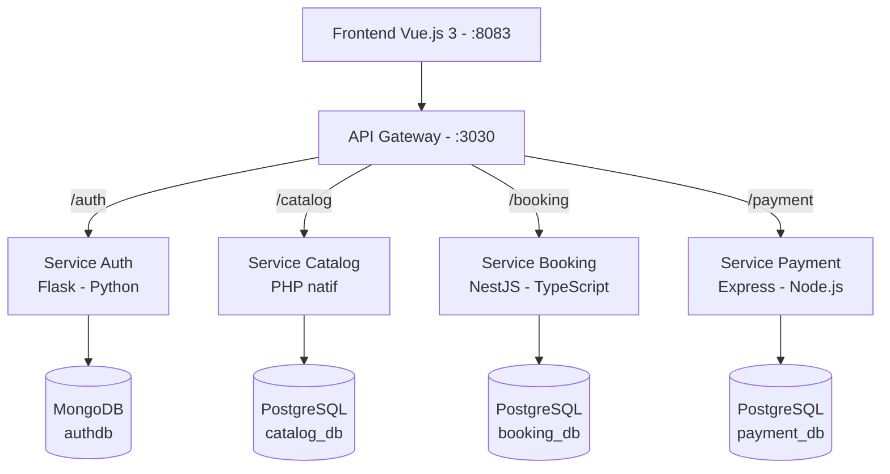

# 🎬 CENTRAL CINEMA — Application de réservation de billets de cinéma

Application web de réservation de billets de cinéma, développée dans le cadre d'un
**projet noté** sur l'**architecture microservices**.

Elle permet de :

* consulter les films à l'affiche,
* parcourir le planning des séances,
* réserver des places et payer en ligne,
* gérer les utilisateurs et les rôles (admin / client).

---

## 🧩 Architecture générale

L'application repose sur une **architecture microservices** avec un **API Gateway**
comme unique point d'entrée. Le frontend ne parle qu'à la gateway, qui route ensuite
vers le microservice concerné. **Chaque microservice possède sa propre base de données.**



> ℹ️ Les routes publiques de la gateway portent **le nom du service**
> (`/auth`, `/catalog`, `/booking`, `/payment`). Chaque microservice écoute
> nativement sur son préfixe : aucune réécriture de chemin n'est nécessaire.

---

## 🧪 Microservices

### 🔐 Auth — Authentification & Utilisateurs
* **Techno** : Python / **Flask** (application factory + Blueprints)
* **Base** : **MongoDB** (`authdb`, via `pymongo`)
* **Port interne** : `4002`
* **Rôle** : inscription, connexion/déconnexion, profil, rôles (admin/client),
  génération & validation des **tokens JWT**.

### 🎞️ Catalog — Catalogue de films
* **Techno** : **PHP natif** (PDO, sans framework)
* **Base** : **PostgreSQL** (`catalog_db`)
* **Port interne** : `4001`
* **Rôle** : CRUD des films, consultation du catalogue, **service des affiches**
  (fichiers statiques sous `/catalog/images/posters/…`).

### 📅 Booking — Séances & Réservations
* **Techno** : **NestJS** (TypeScript) + **TypeORM**
* **Base** : **PostgreSQL** (`booking_db`)
* **Port interne** : `4003`
* **Rôle** : gestion des séances (salle, horaires, places) et des **réservations**
  (routes protégées par JWT).

### 💳 Payment — Paiements
* **Techno** : **Node.js / Express** (driver `pg`)
* **Base** : **PostgreSQL** (`payment_db`)
* **Port interne** : `4004`
* **Rôle** : traitement et suivi des paiements liés aux réservations.

### 🚪 API Gateway
* **Techno** : Node.js / Express + `http-proxy-middleware`
* **Port** : `3030` (exposé)
* **Rôle** : point d'entrée unique, CORS, relais vers les microservices.

---

## 🖥️ Frontend

* **Framework** : Vue.js 3 · **Bundler** : Vite · **State** : Pinia · **Routing** : Vue Router
* **Style** : Tailwind CSS — **thème sombre unique** (palette « indigo »), piloté par
  variables CSS (`src/theme.css` + `tailwind.config.js`).
* Appels à l'API Gateway via **Axios** (le token JWT est ajouté automatiquement par un
  interceptor). Servi en production par **Nginx**.

---

## 🔁 Routes principales (via l'API Gateway `:3030`)

| Action                     | Méthode | Endpoint                     | Service  |
| -------------------------- | ------- | ---------------------------- | -------- |
| Inscription                | POST    | `/auth/register`             | auth     |
| Connexion                  | POST    | `/auth/login`                | auth     |
| Profil courant             | GET     | `/auth/me`                   | auth     |
| Liste des films            | GET     | `/catalog/movies`            | catalog  |
| Détail d'un film           | GET     | `/catalog/movies/:id`        | catalog  |
| Affiches (statique)        | GET     | `/catalog/images/posters/…`  | catalog  |
| Liste des séances          | GET     | `/booking`                   | booking  |
| Créer une réservation 🔒   | POST    | `/booking/reservation`       | booking  |
| Mes réservations 🔒        | GET     | `/booking/reservation/my`    | booking  |
| Traiter un paiement        | POST    | `/payment/process`           | payment  |

🔒 = nécessite un token JWT valide.

---

## 🔐 Authentification (JWT)

* Authentification par **JWT** (algorithme **HS256**).
* Le token est stocké côté client (localStorage) et renvoyé à chaque requête protégée.
* ⚠️ **Important** : le secret de signature (`SECRET_KEY`) doit être **identique** entre
  le service `auth` (qui signe le token) et le service `booking` (qui le vérifie), sinon
  les réservations sont rejetées en `401`. Ce secret est défini dans `docker-compose.yml`.

---

## 🚀 Lancement du projet

### Prérequis
* **Docker** + **Docker Compose**

### Démarrer (tout en conteneurs)

À la racine du projet :

```bash
docker compose up --build
```

Services accessibles une fois démarré :

| Service       | URL                        |
| ------------- | -------------------------- |
| **Frontend**  | http://localhost:8083      |
| **API Gateway** | http://localhost:3030    |

Arrêter : `Ctrl+C` puis `docker compose down`
(ajouter `-v` pour réinitialiser aussi les bases de données).

### Développement frontend (hors Docker)

```bash
cd front
npm install
npm run dev   # Vite sur http://localhost:5173
```

---

## 🔌 Ports & composants

| Composant       | Image / techno        | Port interne | Exposé sur l'hôte |
| --------------- | --------------------- | ------------ | ----------------- |
| Frontend        | Vue 3 + Nginx         | 80           | **8083**          |
| API Gateway     | Node / Express        | 3030         | **3030**          |
| Auth            | Flask                 | 4002         | —                 |
| Catalog         | PHP                   | 4001         | —                 |
| Booking         | NestJS                | 4003         | —                 |
| Payment         | Express               | 4004         | —                 |
| MongoDB         | `mongo:6.0`           | 27017        | —                 |
| Mongo Express   | `mongo-express:1.0.0` | 8081         | — *(ajouter un mapping de port pour y accéder)* |
| PostgreSQL      | `postgres:16-alpine`  | 5432         | —                 |

> Les microservices et les bases ne sont **pas** exposés directement : tout passe par la
> gateway. C'est volontaire (pattern API Gateway : surface d'exposition minimale).

---

## ⚙️ Variables d'environnement notables (`docker-compose.yml`)

| Variable            | Service          | Rôle                                                                 |
| ------------------- | ---------------- | -------------------------------------------------------------------- |
| `SECRET_KEY`        | auth **et** booking | Clé de signature/vérification JWT — **doit être identique** des deux côtés |
| `PUBLIC_BASE_URL`   | catalog          | URL publique (la gateway) utilisée pour construire les URLs d'affiches |
| `MONGO_DB` / `MONGO_USER` / `MONGO_PASSWORD` / `MONGO_HOST` | auth | Connexion MongoDB |
| `DB_HOST` / `DB_NAME` / `DB_USER` / `DB_PASSWORD` | catalog, booking, payment | Connexion PostgreSQL |
| `FRONTEND_ORIGIN`   | booking          | Origine autorisée en CORS (doit correspondre à l'URL du front : `http://localhost:8083`) |

---

## 🎓 Objectifs pédagogiques

* Comprendre et mettre en œuvre une **architecture microservices**.
* Utiliser **plusieurs technologies backend** (Flask, PHP, NestJS, Express).
* Mettre en place un **API Gateway** comme point d'entrée unique.
* Gérer l'**authentification JWT** partagée entre services.
* Séparer clairement **frontend** et **backend**, chaque service avec sa **propre base**.

---

🎬 **CENTRAL CINEMA — Projet Microservices**
